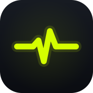
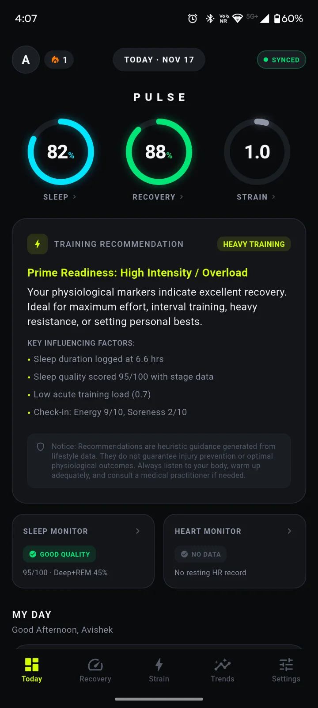
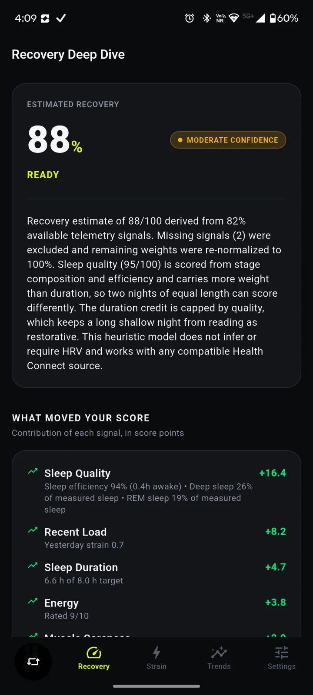
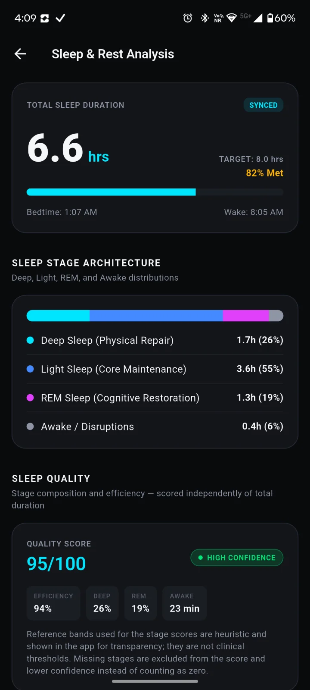

<p align="center">
  
</p>

<h1 align="center">PULSE Fitness</h1>

<p align="center">
  <b>Recovery, sleep and training-load insight from Android Health Connect — measured, explainable, on-device.</b>
</p>

<p align="center">
  
  
  
  
  
</p>

<p align="center">
  <sub>PULSE is an experimental wellness app, not a medical device. Scores are heuristic estimates — never diagnosis or treatment.</sub>
</p>

---

## Why PULSE

Most recovery apps want a subscription and a specific wearable. PULSE works with
whatever your tracker already writes into Android **Health Connect**: sleep,
heart rate, resting heart rate, steps, active calories and workouts.

- **No account, no cloud backend, no ads.** Everything is computed and stored on
  the phone in local SQLite.
- **Explainable scores.** Every recovery number lists the signals behind it and
  how many points each one added or removed.
- **No invented data.** A missing signal is shown as *unavailable* and excluded
  from the maths — it is never silently treated as zero.
- **No HRV dependency.** Built for affordable trackers that only expose BPM.
- **Quiet cards.** A card shows its numbers and the facts behind them, then
  stops. Repeated legal boilerplate stays out of the interface, and data-quality
  notes live on their own line instead of crowding a card header.

## Screens

<table align="center">
  <tr>
    <td align="center" width="33%">
      <br/>
      <sub><b>Today</b><br/>Rings, then the reasoning</sub>
    </td>
    <td align="center" width="33%">
      <br/>
      <sub><b>Recovery</b><br/>What moved your score, in points</sub>
    </td>
    <td align="center" width="33%">
      <br/>
      <sub><b>Sleep</b><br/>Stage architecture and quality</sub>
    </td>
  </tr>
</table>

**Today** answers one question at a glance — *how ready am I today?*

| Block | What it shows |
| --- | --- |
| Header | Profile, check-in streak, current day, Health Connect sync state |
| **Sleep ring** | Sleep performed against your personal target |
| **Recovery ring** | Today's recovery score and category |
| **Strain ring** | Accumulated cardiovascular + movement load (0–21) |
| Training recommendation | Heavy / moderate / light / rest, with the key factors that drove the call and nothing more |
| Sleep & Heart monitor | Sleep-quality status and resting HR versus your own baseline, plus an on-card note when the tracker reported partial or no data |
| My Day | Today's synced workouts |

**Recovery** never shows a number without its reasons: the estimate, its
confidence, and a per-signal breakdown such as *Sleep Quality +16.4*,
*Recent Load +8.2*, *Sleep Duration +4.7* — including which signals were missing
and how the weights were renormalized around them.

**Sleep** keeps the night separate from naps, draws the stage architecture
(deep / light / REM / awake), and scores quality independently of duration, with
the reference bands stated in the app rather than hidden in code.

## How scoring works

### Sleep: quality first, duration second

A night and a nap are different things, and length alone is not recovery.

- **Night classification** — a session counts as the night when the majority of
  its minutes fall inside the 18:00 → 12:00 band (midnight is handled).
- **Primary vs naps** — the primary sleep is the longest *nighttime* session.
  Naps are listed separately with their start/end times and never replace,
  reduce or inflate the night score.
- **Duplicates** — sessions overlapping by ≥ 50% of the shorter one are counted
  once, so multi-source records are not double counted.
- **Quality** — built from sleep efficiency (75% → 95%) and deep/REM shares
  against reference targets (15% deep, 22% REM, no penalty above target).
  Weights: efficiency `0.40`, deep `0.30`, REM `0.30`, renormalized over what the
  tracker actually reported. No stage data means *unavailable*, not a zero.
- **Duration is capped by quality** — duration credit is limited to
  `min(duration, (100 + quality) / 2)`, so eight restless hours cannot score
  like eight well-architected hours.

### Recovery: transparent weights

| Factor | Weight |
| --- | --- |
| Sleep quality | 0.30 |
| Nighttime heart rate | 0.18 |
| Sleep duration (quality-capped) | 0.15 |
| Recent training load | 0.15 |
| Energy check-in | 0.08 |
| Soreness check-in | 0.08 |
| Fatigue check-in | 0.06 |

Missing signals are dropped and the remaining weights renormalized; a score
needs at least 35% weight coverage, and confidence falls as coverage shrinks.
Each factor reports `(component − 50) × normalized weight`, which sums to the
final score's offset from neutral.

**Nighttime heart rate without HRV.** PULSE uses overnight BPM directly: nightly
average, lowest, p95 highest, stability and trend against your own baseline
(minimum 3 nights; resting-HR history is the fallback). Samples deviating more
than 35 bpm from the night median are treated as movement artifacts, and a night
needs 5 valid samples. Nighttime HR *replaces* resting HR in the score rather
than counting the same physiology twice.

## Project layout

```text
lib/
├── core/            # design tokens (colours, typography) and date utilities
├── data/            # Health Connect, SQLite, mock generator, repositories
├── domain/          # algorithms + models, framework-free and unit tested
│   ├── algorithms/  # sleep processor, quality, nighttime HR, recovery, strain
│   └── models/
└── presentation/    # screens, dashboard widgets, providers (Provider)
test/
└── domain/          # algorithm tests (classification, quality, recovery, HR)
tool/                # icon generator (node tool/generate_app_icons.js)
```

## Getting started

**Requirements:** Flutter SDK (3.44+), Android SDK, a JDK matching the toolchain,
and Health Connect on the device for real data.

```bash
flutter pub get
flutter run
```

Quality gates used by this project:

```bash
dart format lib test
flutter analyze
flutter test
```

On first launch, grant only the Health Connect types you are comfortable with —
partial permissions are handled gracefully, and un-granted metrics simply show as
unavailable with a lower confidence. No Health Connect data at all? Turn on
**Demo mode** in Settings for clearly labelled synthetic telemetry.

## Install the app

Download the APK from the **Releases** section of the
[PULSE-Fitness repository](https://github.com/avishekpandit14/PULSE-Fitness) when
a release is available, or build one locally:

```bash
flutter build apk --debug      # installable, signed with the debug key
adb install -r build/app/outputs/flutter-apk/app-debug.apk
```

Release APKs require your own keystore. Signing credentials stay outside the
repository; the Gradle config reads:

```text
PULSE_KEYSTORE_PATH
PULSE_KEYSTORE_PASSWORD
PULSE_KEY_ALIAS
PULSE_KEY_PASSWORD
```

Never commit keystores, passwords or `.env` files.

## Privacy

Health data is read from Health Connect on-device, processed locally and stored
in local SQLite. There is no application-owned backend, no analytics SDK and no
advertising. See [PRIVACY.md](PRIVACY.md) for the full explanation.

## Limitations

- **No HRV.** Heart-rate analysis uses nighttime BPM only and makes no HRV-based
  claims.
- **Baselines need history.** A nightly HR baseline needs 3 nights; resting HR
  is the fallback until then.
- **Stage-less trackers** yield an efficiency-only sleep quality (low confidence).
- **Awake episodes** are not available from Health Connect — only awake minutes.
- **Merged naps** inside one long sleep record cannot be separated.
- **HR coverage** is measured in 30-minute buckets, so short gaps are not
  individually flagged.
- **Compatibility varies.** Tracker support depends entirely on what the
  companion app writes to Health Connect.
- **Heuristics, not medicine.** Recovery and strain are estimates.

## Contributing

Issues and pull requests are welcome — see [CONTRIBUTING.md](CONTRIBUTING.md) and
[CODE_OF_CONDUCT.md](CODE_OF_CONDUCT.md). Please run the three quality gates
above before opening a PR, and keep new scoring logic covered by tests in
`test/domain/`.

## License

Released under the [MIT License](LICENSE).
